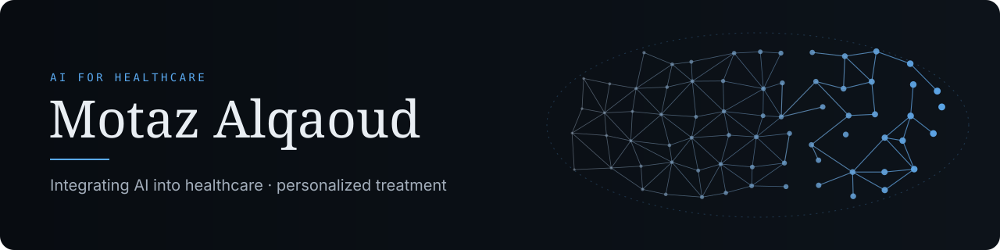
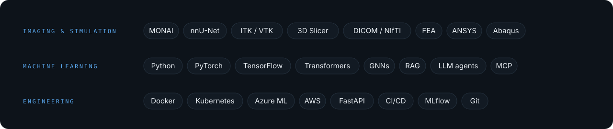

  

I'm a biomedical engineer in AI for healthcare. I believe the real promise of AI in medicine is personalization: care shaped around each patient's own anatomy, data and course of treatment, rather than around the average patient. My aim is to help move AI from research into tools that clinicians trust and that make a real difference for patients.

### Expertise

- **Medical imaging.** Segmentation and registration across Medical image modalities (MRI, CT, X-ray, and ultrasound).
- **Surgical navigation and treatment planning.** Image-guided surgery and patient-specific planning, from preoperative imaging to the operating room.
- **Simulation and modeling.** Finite-element modeling and analysis of tissue, combined with AI to keep the accuracy of physics-based simulation at the speed clinical use demands.
- **Clinical decision support.** Diagnostic, treatment and follow-up support tools, including language-model systems that cite their evidence and decline when they should.
- **Personalized care.** Patient-specific models that adapt diagnosis, treatment and follow-up to the individual.
- **Regulated AI.** Validation, documentation and engineering practice for AI that has to hold up in a clinical setting.

### Projects

| Project | Focus |
| --- | --- |
| [clinical-agent-platform](https://github.com/motazalqaoud/clinical-agent-platform) | A clinical question-answering service over guidelines and FHIR patient data, with dose verification, safety guardrails and an evaluation gate in CI |
| [Brain-Tumor-Segmentation](https://github.com/motazalqaoud/Brain-Tumor-Segmentation) | 3D segmentation of brain tumours from multi-modal MRI with an attention U-Net |
| [Oncology-diagnosis-using-CNN](https://github.com/motazalqaoud/Oncology-diagnosis-using-CNN) | Skin lesion classification with an [in-browser demo](https://huggingface.co/spaces/motazalqaoud/skin-lesion-classifier), reported with the sensitivity figures that matter clinically |
| [open-source-model-weights](https://github.com/motazalqaoud/open-source-model-weights) | Model cards and verification tooling for released medical-imaging checkpoints |

### Research

Breast cancer surgery: multi-modality MRI segmentation, biomechanical simulation of breast tissue, and MRI-to-ultrasound registration for surgical navigation.

- *Simulation of Breast Deformation Due to US Probe.* ANNSIM 2025. [IEEE Xplore](https://ieeexplore.ieee.org/document/11118667)
- *Multi-Material, Approach-Guided, Controlled-Resolution Breast Meshing for FE-Based Interactive Surgery Simulation.* ANNSIM 2023. [IEEE Xplore](https://ieeexplore.ieee.org/document/10155366)
- *Multi-Modality Breast MRI Segmentation Using nnU-Net for Preoperative Planning of Robotic Surgery Navigation.* ANNSIM 2022. [IEEE Xplore](https://ieeexplore.ieee.org/document/9859361)
- *nnU-Net-based Multi-modality Breast MRI Segmentation and Tissue-Delineating Phantom for Robotic Tumor Surgery Planning.* IEEE EMBC 2022. [IEEE Xplore](https://ieeexplore.ieee.org/document/9871109)
- *Real-Time Navigation System for Breast Cancer Surgery with Pre- and Intra-Operative Imaging Using Neural Networks.* PhD dissertation, Old Dominion University, 2024. [ODU Digital Commons](https://digitalcommons.odu.edu/biomedengineering_etds/30/)

All publications on [Google Scholar](https://scholar.google.com/citations?user=jn_uQ1YAAAAJ&hl=en).

### Toolbox

  

### Read more

- **Second Opinion**: a newsletter on the evidence behind AI in healthcare, every two weeks on LinkedIn.
- **[motazalqaoud.com](https://motazalqaoud.com)**: projects, research and background in one place.
- **[Hugging Face](https://huggingface.co/motazalqaoud)**: models and live demos.

Personal projects, built with public data and tools. They do not represent my employer.
